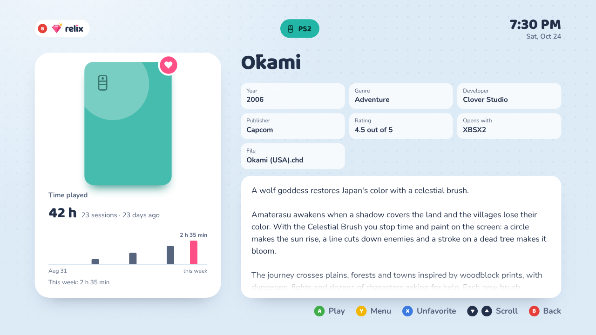
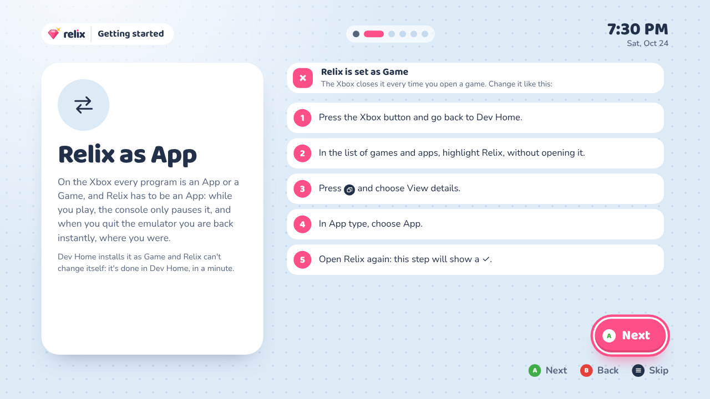
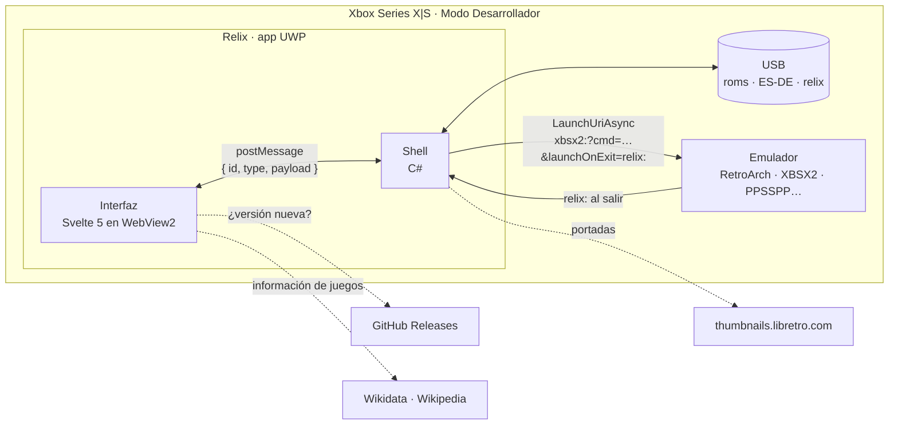

<p align="center"></p>

<p align="center"><strong>Tus reliquias, listas para jugar.</strong><br>
Un lanzador de juegos para emuladores en Xbox Series X|S en Modo Desarrollador.</p>

<p align="center">
  <a href="https://github.com/Snyker-fair/relix/actions/workflows/ci.yml"></a>
  <a href="https://github.com/Snyker-fair/relix/releases/latest"></a>
  <a href="LICENSE"></a>
  <a href="https://ko-fi.com/snyker"></a>
</p>

<p align="center">
  <a href="https://snyker-fair.github.io/relix/"><b>Prueba la demo en el navegador</b></a> ·
  <a href="https://github.com/Snyker-fair/relix/releases/latest">Descargar</a> ·
  <a href="README.md">Read in English</a>
</p>

<p align="center"></p>

Relix escanea la carpeta `roms` de tu USB, lista cada juego en su consola y lo
abre en el emulador que corresponde: RetroArch, XBSX2, PPSSPP, Xenia y más. Baja
las portadas desde la misma consola, guarda tus favoritos, colecciones y tiempo
de juego en el USB, y cuando algo falta te dice exactamente qué y abre una guía
paso a paso para arreglarlo. Lee y escribe las mismas carpetas que
[ES-DE](https://es-de.org): escrapeas en el PC y juegas en la TV.

Está pensado para leerse a tres metros y manejarse con el control: letra grande,
formas redondeadas, un color por consola y una barra que siempre dice qué hace
cada botón. Logo, colores, tipografía y voz de la marca están en
[`brand/`](brand/README.md).

> **Antes de usarlo:** Relix no está afiliado a Microsoft, Sony, Nintendo, Sega ni a
> los autores de los emuladores. No incluye juegos, BIOS ni claves: los juegos y las
> BIOS deben salir de tus propias consolas. Solo funciona en una Xbox en **Modo
> Desarrollador**; no es una app de la Microsoft Store.

## Qué hace

- **Toda tu biblioteca en una repisa.** Un canal por consola, en el orden que
  elijas (*≡ › Consolas*, **X**), Favoritos, Colecciones y *Seguir jugando*. Doce
  consolas: PS1, PS2, PSP, SNES, N64, GBA,
  GameCube, Wii U, 3DS, Mega Drive, Dreamcast y Xbox 360.
- **Copiar y escanear, nada más.** Al escanear una consola en *≡ › Biblioteca*
  también llegan las portadas de sus juegos desde
  [libretro-thumbnails](https://github.com/libretro-thumbnails) (las mismas de
  RetroArch) y las descripciones de las que Wikipedia está segura. Si el nombre
  de un archivo es dudoso, Relix no adivina: te deja elegir entre las más
  parecidas. Un juego de PS1 o Dreamcast de varios discos tampoco pide nada más:
  copia cada disco y Relix muestra un solo juego y arma la lista para cambiar de
  disco.
- **Información de los juegos desde Wikipedia.** Para los juegos que ES-DE no
  scrapeó: *Y › Buscar información…*, o *≡ › Biblioteca › Información de los
  juegos* para todos, agrega la descripción, el año, el género, la desarrolladora
  y la editora desde [Wikidata](https://www.wikidata.org) y
  [Wikipedia](https://es.wikipedia.org) al `gamelist.xml` de ES-DE, en español o
  inglés. Sin cuentas ni claves, y sin reemplazar nada de lo que ya hay.
- **Nombres de archivo estándar.** *Y › Renombrar archivo…* (o *≡ › Biblioteca ›
  Nombres de archivo* para todos a la vez) cambia `kh2.iso` por
  `Kingdom Hearts II (USA).iso`, eligiendo entre los nombres de libretro con su
  portada o escribiéndolo. Sus otros discos, las imágenes de ES-DE, su ficha en
  `gamelist.xml`, las partidas de RetroArch en el USB, las colecciones y el tiempo
  de juego se mueven con él.
- **Elige tu emulador.** Uno recomendado por consola, otro por consola en
  Opciones, o por juego con *Abrir con…*. Relix le pregunta a la Xbox cuáles hay
  instalados.
- **Encuentra rápido.** Búsqueda en todas las consolas con teclado en pantalla,
  saltos por letra con los gatillos, orden (A–Z, recientes, más jugados, año) y
  filtros por género. ¿No sabes qué jugar? *Sorpréndeme* (el dado del
  inicio, o el stick izquierdo dentro de una consola) elige uno, casi siempre uno
  que no has jugado. Los juegos que trae un escaneo se marcan *Nuevo*.
- **Ficha viva.** Fanart y logo cuando ES-DE los escrapeó; una captura de
  libretro como fondo cuando no. Sin videos: costarían más memoria y fluidez de la
  que Relix puede gastar. Con clic del stick derecho (o *Y › Ver
  ficha*) se abre la ficha completa: la descripción entera, todos los datos y tus
  semanas con ese juego.
- **Tiempo de juego.** Tiempo y partidas por juego, salgas desde el emulador o
  vuelvas con el botón Xbox, y tus últimas 8 semanas con tu top 5 en *Opciones ›
  Acerca de*. Si la Xbox cerró Relix mientras jugabas, se abre donde estabas: la
  misma biblioteca, con ese juego enfocado.
- **Te dice qué falla.** La *Revisión* comprueba el USB, el espacio, los
  emuladores y las BIOS que faltan (según la región de tus juegos de PS1), y si
  Relix está como App en Dev Home. Si un juego se cierra al abrir, Relix dice qué
  BIOS o núcleo revisar. Cada consola tiene su guía: qué instalar desde DevStore,
  qué archivos pide y dónde van, con un QR para el celular.
- **Tus datos viajan con el USB.** Favoritos, colecciones, tiempo de juego y
  preferencias se guardan en `relix\data.json`, con la copia anterior y un
  respaldo por día de la última semana. Reinstala Relix o cambia de Xbox y todo
  sigue ahí.
- **Registro de diagnóstico.** Cada juego que abres (con su URI exacta), cómo
  volvió, cada error y cuánta memoria usa Relix, en `relix\log.txt` y en pantalla
  en Revisión.
- **Español e inglés**, automático según el idioma de la consola. **Tema claro y
  oscuro**, con un modo automático para la noche. **Protector de pantalla** con
  tus juegos y **aviso de versión nueva** cuando sale una.

<table>
  <tr>
    <td></td>
    <td></td>
  </tr>
  <tr>
    <td></td>
    <td></td>
  </tr>
  <tr>
    <td></td>
    <td></td>
  </tr>
  <tr>
    <td></td>
    <td></td>
  </tr>
</table>

Las capturas son de la demo en inglés y usan las portadas de color de Relix; la
demo y la consola muestran las reales de libretro.

## Instalar

Necesitas una Xbox Series X|S en
[Modo Desarrollador](https://learn.microsoft.com/es-es/windows/uwp/xbox-apps/devkit-activation),
un disco USB y un PC en la misma red.

1. Desde la [última versión](https://github.com/Snyker-fair/relix/releases/latest),
   baja el paquete `.msix` y el `.zip` de dependencias, y descomprime el zip.
2. Abre el **Device Portal** (la dirección que muestra Dev Home) › **My games &
   apps** › **Add**. Elige el `.msix` y, cuando pida dependencias, agrega los
   archivos de la carpeta de dependencias.
3. **Cambia Relix a App, el paso más importante.** Dev Home lo instala como
   **Game**, y como Game la Xbox cierra Relix cada vez que abres un juego, así que
   al volver carga todo otra vez. Como **App** la Xbox solo lo pausa, y al salir
   del juego vuelves al instante. En **Dev Home**, ponte sobre Relix (sin abrirlo)
   › botón Vista ⧉ › **View details** › **App type** › **App**, y abre Relix. El
   recorrido de bienvenida lo revisa primero, y **Opciones › Revisión** lo cuenta
   como algo por arreglar hasta que sea App. (Los emuladores sí van como Game: sus
   guías explican cómo.)
4. En el PC, crea en el USB una carpeta por consola: `E:\roms\psx`,
   `E:\roms\ps2`, `E:\roms\snes`… (los nombres de ES-DE) y copia ahí tus juegos.
5. Conecta el USB a la Xbox y abre Relix. El recorrido de bienvenida y
   **Opciones › Revisión** dicen qué emuladores y BIOS faltan, y la guía de cada
   consola explica cómo instalarlos desde DevStore.

Para actualizar, instala el `.msix` nuevo de la misma forma: tus datos están en
el USB. Relix avisa cuando hay una versión nueva.

## Cómo funciona



- **Abrir un juego es abrir una URI.** Cada emulador registra un protocolo
  (`retroarch:`, `xbsx2:`, `ppsspp:`…); Relix arma la línea de comandos con la ruta
  del juego y `launchOnExit=relix:`, así la Xbox vuelve a Relix al cerrar el
  emulador. Es el mismo formato de otros frontends para Xbox (ver
  `src/lib/core/launchUri.js`).
- **El shell es chico y hace lo nativo:** lee el USB, lista archivos, baja y achica
  portadas, guarda tus datos sin dejarlos a medias, lee el control con
  `Windows.Gaming.Input` (sin modo mouse ni los problemas de foco de WebView2) y
  sirve la interfaz desde `https://relix.example` sin salir a la red.
- **La interfaz hace todo lo demás** y también corre en un navegador común con
  datos de prueba: esa es la [demo](https://snyker-fair.github.io/relix/).

### Decisiones de diseño

- **WebView2 + Svelte en vez de XAML.** La interfaz se trabaja en el navegador con
  recarga al instante y se depura con las DevTools de Edge desde el PC. Svelte
  compila a JavaScript chico y rápido: la Xbox mueve la interfaz mientras los
  emuladores necesitan la memoria.
- **Lógica pura, con tests.** Todo lo que decide algo (elegir la portada, armar la
  URI, qué copia de tus datos manda, las reglas de la revisión, comparar versiones)
  está en `src/lib/core/` sin interfaz, con más de 240 tests.
- **Compatible con ES-DE a propósito.** Relix lee los gamelists y la media de ES-DE
  y guarda portadas y colecciones donde ES-DE las busca. Un mismo USB sirve en el PC
  y en la Xbox, sin convertir nada.
- **Los datos en el USB, no en la app.** Los datos de una app UWP se borran al
  desinstalarla, y una app en Modo Desarrollador se reinstala seguido.
  `data.json` se escribe a través de un archivo temporal, guarda la versión
  anterior y respaldos diarios, y Relix usa la copia válida más nueva.
- **Decir qué falla, no solo que falló.** Un emulador nunca le dice a Relix por qué
  se cerró: Relix lo deduce (se cerró antes de 15 s = no abrió) y apunta a la causa
  probable; la Revisión convierte cada problema en una guía.
- **Traducciones sin claves.** Los textos se escriben en español en el código y
  pasan por `t()`; `src/lib/i18n/en.js` tiene cada uno en inglés. El código se lee
  igual, y un test falla si a un texto (también a los que se arman al correr, como
  los pasos de las guías) le falta su traducción.

## Desarrollo

```bash
npm install
npm run dev            # la interfaz en el navegador, con datos de prueba
npm test               # tests de la lógica y de las traducciones (vitest)
npm run build          # dist/ para el paquete UWP
npm run build:single   # dist-single/index.html autocontenido (la demo)
npm run build:shell    # compila y copia la interfaz al proyecto de Visual Studio
node scripts/i18n.mjs  # textos que todavía no tienen su versión en inglés
RELIX_LIVE=1 npx vitest run tests/gameInfo.live.test.js  # la información de los juegos contra Wikidata real (pide internet)
```

En el navegador: flechas, Enter (A), Esc (B), X, Y, Q/E (LB/RB), Z/C (LT/RT), V
(Vista) y M (Menú). Un control de Xbox conectado al PC también funciona.

```
src/
  lib/core/     lógica pura con tests: consolas, URIs, ES-DE, portadas, búsqueda,
                orden, tus datos, revisión, guías, versiones…
  lib/i18n/     t(), tn(), plural() y el catálogo en inglés
  lib/ui/       estados y piezas compartidas (control, sonidos, portadas…)
  screens/      Home, Library, Search, GameMenu, Options, Guide, Welcome…
  mock/         gamelists de ES-DE y nombres de libretro para la demo y los tests
shell/          el shell en C# (RelixShell) y su proyecto de Visual Studio
tests/          vitest
docs/           guías para compilar y probar en la TV, imágenes del README
brand/          logo, íconos de la app y guía de marca
```

Los commits siguen [Conventional Commits](https://www.conventionalcommits.org/en/v1.0.0/)
([`docs/BUILDING.md`](docs/BUILDING.md#commits)). Cada cambio corre los tests y
las dos compilaciones en GitHub Actions; `main` publica la demo en GitHub Pages,
y cada etiqueta `v*` compila y firma el paquete para la Xbox como un release en
borrador, que se publica a mano después de probarlo en la consola. Las guías, en
inglés: cómo funciona el shell ([`shell/README.md`](shell/README.md)), compilar y
publicar ([`docs/BUILDING.md`](docs/BUILDING.md)) y qué probar en la TV
([`docs/TESTING.md`](docs/TESTING.md)).

### Traducciones

```js
t('Seguir jugando')                        // "Continue playing"
t('Juego {n} de {total}', { n, total })    // "Game 3 of 9"
tn(n, '{n} juego nuevo', '{n} juegos nuevos')
plural(n, 'juego', 'juegos')               // "3 games"
```

`node scripts/i18n.mjs` lista los textos que todavía no tienen su versión en
inglés, listos para copiar a `en.js`. `tests/i18n.test.js` falla si falta alguno,
si los `{nombres}` no coinciden o si una guía, un chequeo de la revisión o un aviso
queda sin traducir.

## Carpetas en el USB

| Qué | Dónde |
|---|---|
| Juegos | `E:\roms\<consola>\` (nombres de ES-DE: `psx`, `ps2`, `psp`, `snes`, `n64`, `gba`, `gc`, `wiiu`, `n3ds`, `megadrive`, `dreamcast`, `xbox360`; también `ps1`, `genesis`, `3ds`, `dc`…) |
| Gamelists | `E:\ES-DE\gamelists\<consola>\gamelist.xml` (la primera vez que Relix agrega información, el original queda como `gamelist.xml.relix-backup`) |
| Portadas | `E:\ES-DE\downloaded_media\<consola>\covers\` (las de ES-DE y las que baja Relix) |
| Fondos y logos | `…\fanart\`, `…\screenshots\`, `…\marquees\` (de ES-DE) |
| Colecciones | `E:\ES-DE\collections\custom-<Nombre>.cfg` (las ve también ES-DE) |
| Tus datos | `E:\relix\data.json`, `data.previous.json` y `backups\` (los últimos 7 días) |
| Registro de diagnóstico | `E:\relix\log.txt` (y `log.previous.txt`) |
| Listas de discos | `E:\relix\discs\<consola>\` (el `.m3u` que Relix arma para los juegos de varios discos) |
| Caché | `E:\relix\cache\` (listas de libretro y miniaturas; se puede borrar) |

Los juegos de PS1 y Dreamcast de varios discos no necesitan nada más: copia cada
disco (`Juego (USA) (Disc 1).chd`, `(Disc 2)`…) y Relix muestra un solo juego y
arma su `.m3u` en `E:\relix\discs` al abrirlo, para cambiar de disco desde el
menú del emulador. Si ya tienes un `.m3u`, Relix usa el tuyo. Los de Xbox 360 y
Dreamcast pueden ir en una carpeta por juego (`Halo 3 (USA)\default.xex`): el
nombre sale de la carpeta.

**Volver a un respaldo:** en el PC, copia el `backups\data-<día>.json` que
quieras encima de `E:\relix\data.json` y abre Relix. Cuando el archivo del USB
cambia por fuera de la app (un respaldo, u otra Xbox), Relix usa el del USB.

Los USB que usaste con Relix 1.0.0 tienen nombres en español (`datos.json`,
`respaldos\`, `registro.txt`): Relix 1.1.0 los renombra la primera vez que abre
el disco, sin sobrescribir ni borrar nada.

### Fondos y logos con ES-DE (en el PC)

Relix no escrapea por su cuenta (ScreenScraper pide una clave de desarrollador):
usa lo que ES-DE deja en el USB. Una vez por consola:

1. Instala [ES-DE](https://es-de.org) en el PC y crea una cuenta gratis en
   [ScreenScraper](https://www.screenscraper.fr): con cuenta, ES-DE escrapea más
   rápido y con más cupo por día.
2. Conecta el USB y deja que ES-DE use `E:\roms` como carpeta de ROMs (la pide la
   primera vez). Así los archivos de ES-DE tienen el mismo nombre que ve la Xbox.
3. Menú de ES-DE → **SCRAPER**:
   - **SCRAPE FROM**: ScreenScraper.
   - **ACCOUNT SETTINGS**: activa **USE THIS ACCOUNT FOR SCREENSCRAPER** y escribe
     tu usuario y contraseña.
   - **CONTENT SETTINGS**: deja activados *fan art*, *marquee (wheel)* (el logo),
     *screenshots*, *box covers* y *other metadata* (descripción y género, que
     usan los filtros). Desactiva *videos*: Relix no los reproduce, y cada uno
     pesa entre 5 y 20 MB en el USB.
   - **SCRAPE THESE SYSTEMS**: las consolas que quieras → **START**.
4. Copia al USB, desde la carpeta de datos de ES-DE en el PC (con el instalador,
   `C:\Users\<tu usuario>\ES-DE`), las carpetas `downloaded_media` y `gamelists`
   dentro de `E:\ES-DE\`. Si Windows pregunta, combina las carpetas: las portadas
   que bajó Relix ya están ahí.
5. Abre Relix: lee los fondos y logos al iniciar.

## Emuladores

El primero de cada fila es el recomendado. Los núcleos de RetroArch se abren con
`retroarch:`; los protocolos de los emuladores sueltos son los mismos que usa
[RetroPass](https://github.com/retropassdev/RetroPass). Se configuran en
`src/lib/core/platforms.js`.

| Consola | Emuladores |
|---|---|
| PS1 | RetroArch SwanStation, RetroArch Beetle PSX HW, DuckStation |
| PS2 | XBSX2 |
| PSP | PPSSPP, RetroArch PPSSPP |
| SNES | RetroArch Snes9x, RetroArch bsnes |
| N64 | RetroArch Mupen64Plus-Next, RetroArch ParaLLEl N64 |
| GBA | RetroArch mGBA, gpSP, VBA-M |
| GameCube | RetroArch Dolphin, Dolphin |
| Wii U | Cemu, se abre desde Dev Home (todavía no registra un protocolo) |
| 3DS | RetroArch 3DS, Panda3DS (los dos experimentales) |
| Mega Drive | RetroArch Genesis Plus GX, RetroArch PicoDrive |
| Dreamcast | RetroArch Flycast, Flycast |
| Xbox 360 | Xenia Canary, Xenia |

Algunos emuladores independientes no abren Relix solos al cerrarse. Vuelve desde
Inicio: Relix sigue donde estabas y suma el tiempo que jugaste.

Switch se suma cuando haya un emulador con protocolo que sea jugable.

## Controles

| Botón | Qué hace |
|---|---|
| A | Abrir / jugar |
| B | Volver |
| X | Favorito (en la búsqueda: borrar letra; en Opciones › Consolas: mover una consola) |
| Y | Menú del juego: jugar, ver ficha, abrir con…, favorito, colecciones, cambiar portada, renombrar, buscar información, ocultar, ordenar, filtrar (en *Seguir jugando*: quitarlo de ahí). En Opciones › Consolas, o en una consola sin juegos: la guía |
| Stick derecho (clic) | La ficha completa del juego |
| Stick izquierdo (clic) | Dentro de una consola o colección: Sorpréndeme, entre sus juegos |
| LB / RB | Consola anterior / siguiente (o colección, dentro de Colecciones) |
| LT / RT | Letra anterior / siguiente (año, si ordenas por año) |
| Vista ⧉ | Buscar en todas las consolas |
| Menú ≡ | Opciones |

## Apoya Relix

Relix es gratis y lo seguirá siendo. Si te sirve y quieres ayudar a que siga
creciendo, puedes invitarme un café en [Ko-fi](https://ko-fi.com/snyker). Es
totalmente voluntario: Relix es el mismo con o sin donación.

## Licencia

Relix es software libre con la [licencia GPL-3.0](LICENSE) (o, a tu elección, una
versión posterior): puedes usarlo, estudiarlo, modificarlo y compartirlo. Si
distribuyes una versión modificada, debe llevar la misma licencia y su código.
Se entrega sin garantía.

Usa [uqr](https://github.com/unjs/uqr) para los códigos QR (MIT) y las letras
[Baloo 2](https://fonts.google.com/specimen/Baloo+2) y
[Nunito](https://fonts.google.com/specimen/Nunito) (SIL Open Font License). Las
portadas son de [libretro-thumbnails](https://github.com/libretro-thumbnails) y se
bajan desde la consola; ninguna viene en este repositorio. La información de los
juegos viene de [Wikidata](https://www.wikidata.org) (CC0) y las descripciones de
[Wikipedia](https://es.wikipedia.org) (CC BY-SA 4.0): cada una lleva su crédito al
final. Los nombres de consolas
y emuladores son marcas de sus dueños y se usan solo para decir con qué funciona
Relix. Los íconos de las consolas están dibujados a mano y no usan logos.

Creado por **[snyker-fair](https://github.com/Snyker-fair)**. ¿Encontraste un
error? Abre un [issue](https://github.com/Snyker-fair/relix/issues/new/choose):
pide los pocos datos que hacen falta para arreglarlo rápido.
