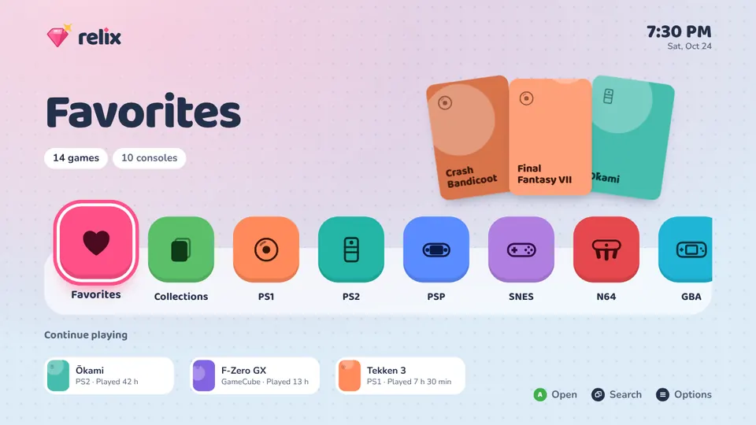
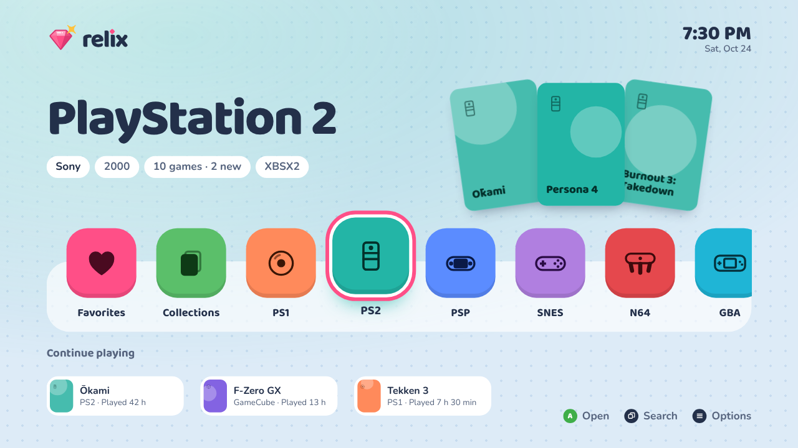
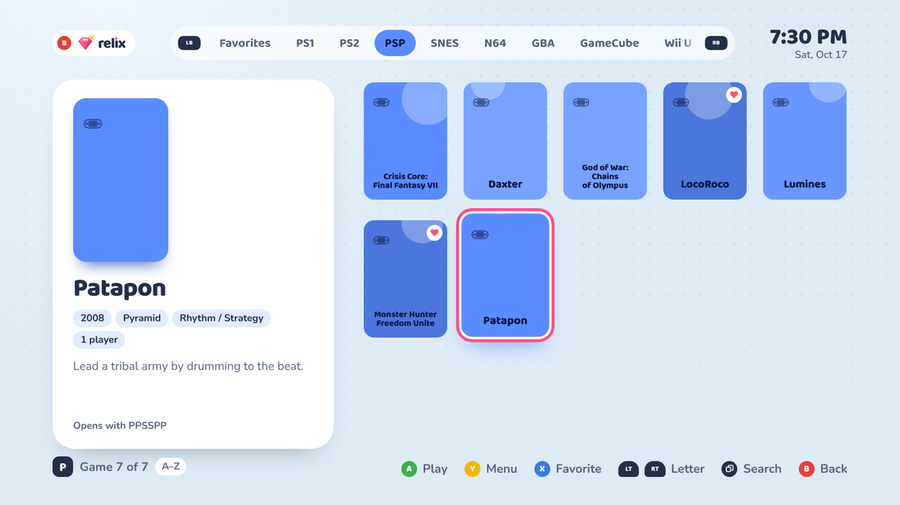
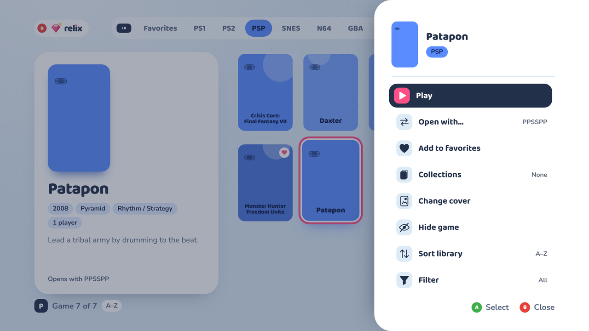
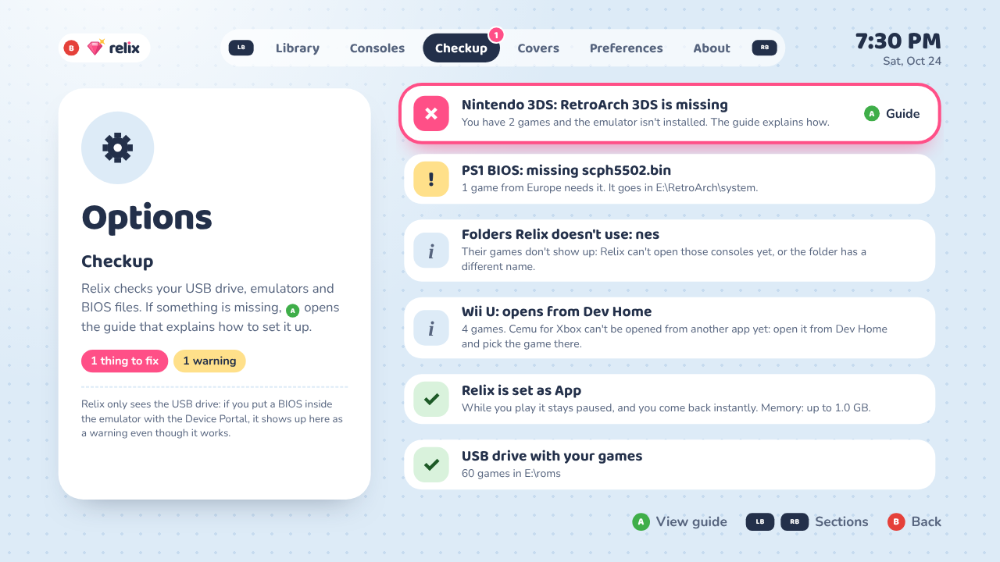
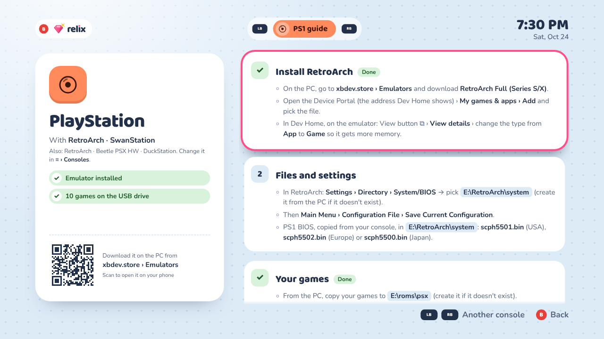
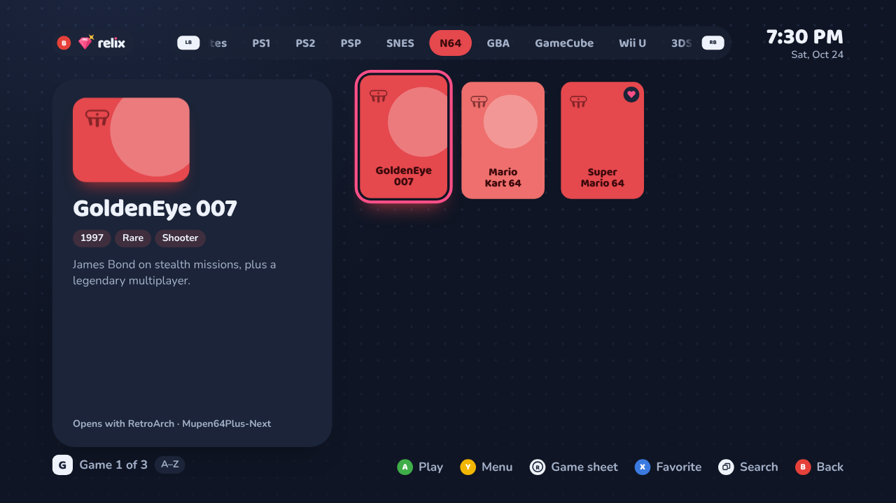
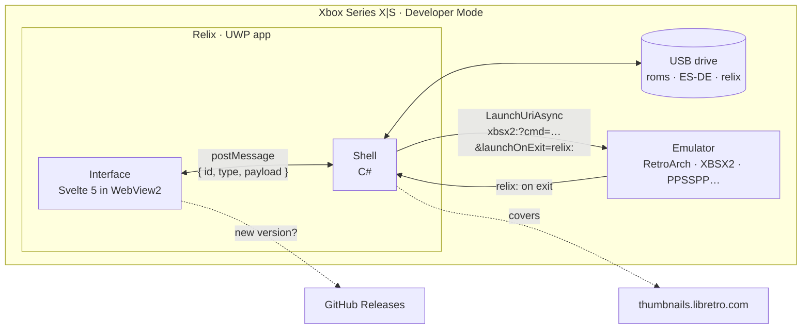

<p align="center"></p>

<p align="center"><strong>Your relics, ready to play.</strong><br>
A game launcher for emulators on Xbox Series X|S in Developer Mode.</p>

<p align="center">
  <a href="https://github.com/Snyker-fair/relix/actions/workflows/ci.yml"></a>
  <a href="https://github.com/Snyker-fair/relix/releases/latest"></a>
  <a href="LICENSE"></a>
</p>

<p align="center">
  <a href="https://snyker-fair.github.io/relix/"><b>Try the demo in your browser</b></a> ·
  <a href="https://github.com/Snyker-fair/relix/releases/latest">Download</a> ·
  <a href="README.es.md">Leer en español</a>
</p>

<p align="center"></p>

Relix scans the `roms` folder on your USB drive, lists every game under its
console and opens it in the right emulator — RetroArch, XBSX2, PPSSPP, Xenia
and more. It downloads covers straight from the console, keeps your favorites,
collections and playtime on the USB drive, and when something is missing it
tells you exactly what and opens a step-by-step guide to fix it. It reads and
writes the same folders as [ES-DE](https://es-de.org), so you can scrape on
your PC and play on the TV.

It is designed to be read from three meters away and driven with a controller:
big type, rounded shapes, a color per console, and a hint bar that always says
what each button does.

> **Before you start:** Relix is not affiliated with Microsoft, Sony, Nintendo,
> Sega or the emulator authors. It does not include games, BIOS files or keys:
> those must come from consoles and discs you own. It only runs on an Xbox in
> **Developer Mode**; it is not a Microsoft Store app.

## Features

- **Your whole library, one shelf.** A channel per console, Favorites,
  Collections and *Continue playing*. Twelve consoles: PS1, PS2, PSP, SNES, N64,
  GBA, GameCube, Wii U, 3DS, Mega Drive, Dreamcast and Xbox 360.
- **Covers without accounts.** Downloaded from
  [libretro-thumbnails](https://github.com/libretro-thumbnails) (the ones
  RetroArch uses). When a file name is ambiguous, Relix doesn't guess: it asks
  you to pick from the closest matches.
- **Standard file names.** *Y › Rename file…* (or *≡ › Library › File names*
  for every file at once) renames `kh2.iso` to `Kingdom Hearts II (USA).iso`,
  picking from libretro's names with their covers or typing it. Its other discs,
  ES-DE images, `gamelist.xml` entry, RetroArch saves on the USB drive,
  collections and playtime move with it.
- **Pick your emulator.** A recommended emulator per console, a different one
  per console in Options, or per game with *Open with…*. Relix asks the Xbox
  which emulators are installed.
- **Find games fast.** Search across every console with an on-screen keyboard,
  jump by letter with the triggers, sort (A–Z, recent, most played, year) and
  filter by genre or players.
- **A living game page.** Fan art, logo and video preview when ES-DE scraped
  them; a background screenshot from libretro when it didn't.
- **Playtime.** Time and sessions per game, counted whether you quit from the
  emulator or come back with the Xbox button.
- **It tells you what's wrong.** *Checkup* verifies the USB drive, free space,
  missing emulators and BIOS files (per region of your PS1 games). If a game
  closes right after launching, Relix tells you which BIOS or core to check.
  Every console has a guide: what to install from DevStore, which files it
  needs and where they go, with a QR code for your phone.
- **Your data travels with the USB drive.** Favorites, collections, playtime and
  settings are saved to `relix\data.json`, with the previous copy and a daily
  backup for a week. Reinstall Relix or move to another Xbox and it's all there.
- **Diagnostic log.** Every launch (with its exact URI), how it came back, and
  every error, in `relix\log.txt` and on screen in Checkup.
- **English and Spanish**, automatic from the console language. **Light and dark
  themes**, with an automatic mode for the evening. A **screensaver** with your
  games, and a **new version notice** when a release is out.

<table>
  <tr>
    <td></td>
    <td></td>
  </tr>
  <tr>
    <td></td>
    <td></td>
  </tr>
  <tr>
    <td></td>
    <td></td>
  </tr>
</table>

The covers in these screenshots are Relix's own color covers; the demo and the
console show the real ones from libretro.

## Install

You need an Xbox Series X|S in
[Developer Mode](https://learn.microsoft.com/windows/uwp/xbox-apps/devkit-activation),
a USB drive and a PC on the same network.

1. From the [latest release](https://github.com/Snyker-fair/relix/releases/latest),
   download the `.msix` package and the dependencies `.zip`, and extract the zip.
2. Open the **Device Portal** (the address Dev Home shows) › **My games & apps** ›
   **Add**. Pick the `.msix`, then add the files from the dependencies folder
   when it asks for them.
3. In **Dev Home**, highlight Relix › View button ⧉ › **View details** › change
   the type from **App** to **Game**, so it gets more memory.
4. On the PC, create a folder per console on the USB drive: `E:\roms\psx`,
   `E:\roms\ps2`, `E:\roms\snes`… (ES-DE names) and copy your games there.
5. Plug the drive into the Xbox and open Relix. The welcome tour and
   **Options › Checkup** tell you which emulators and BIOS files are missing,
   and each console's guide explains how to install them from DevStore.

To update, install the new `.msix` the same way: your data lives on the USB
drive. Relix lets you know when a new version is out.

## How it works



- **Launching a game is opening a URI.** Each emulator registers a protocol
  (`retroarch:`, `xbsx2:`, `ppsspp:`…); Relix builds the command line with the
  game's path and `launchOnExit=relix:`, so the Xbox comes back to Relix when the
  emulator closes. It's the same format other Xbox frontends use (see
  `src/lib/core/launchUri.js`).
- **The shell is small and does the native work**: reads the USB drive (UWP's
  removable storage), lists files, downloads and resizes covers, writes your data
  atomically, reads the controller with `Windows.Gaming.Input` (no mouse mode,
  no WebView2 focus bugs) and serves the interface from `https://relix.example`
  without touching the network.
- **The interface does everything else** and also runs in a regular browser with
  test data — that's the [demo](https://snyker-fair.github.io/relix/).

### Design decisions

- **WebView2 + Svelte instead of XAML.** The interface iterates in the browser
  with hot reload and is debugged with Edge DevTools from the PC. Svelte compiles
  to small, fast JavaScript — the Xbox runs the UI while emulators fight for
  memory.
- **Pure logic, tested.** Everything that decides something — matching covers,
  building URIs, choosing which copy of your data wins, the checkup rules, version
  comparison — lives in `src/lib/core/` without any UI, covered by 150+ tests.
- **ES-DE compatible on purpose.** Relix reads ES-DE's gamelists and media and
  writes covers and collections where ES-DE expects them. One USB drive works on
  the PC and on the Xbox, and nothing needs converting.
- **Data on the USB drive, not in the app.** UWP app data disappears when you
  uninstall; a dev-mode app gets reinstalled often. `data.json` is written
  through a temporary file, keeps the previous version and daily backups, and
  Relix picks the newest copy that is valid.
- **Say what's wrong, not just that something failed.** An emulator never tells
  Relix why it closed, so Relix infers it (closed within 15 s = didn't start)
  and points at the likely cause; Checkup turns each problem into a guide.
- **Translations without keys.** Strings are written in Spanish in the code and
  go through `t()`; `src/lib/i18n/en.js` maps each to English. The code stays
  readable, and a test fails if any string — including dynamic ones like guide
  steps — is missing its translation.

## Development

```bash
npm install
npm run dev            # the interface in your browser, with test data
npm test               # logic and translation tests (vitest)
npm run build          # dist/ for the UWP package
npm run build:single   # dist-single/index.html, self-contained (the demo)
npm run build:shell    # builds and copies the interface into the Visual Studio project
node scripts/i18n.mjs  # strings still missing their English translation
```

In the browser: arrow keys, Enter (A), Esc (B), X, Y, Q/E (LB/RB), Z/C (LT/RT),
V (View) and M (Menu). An Xbox controller plugged into the PC works too.

```
src/
  lib/core/     pure logic with tests: platforms, launch URIs, ES-DE, covers,
                search, sorting, your data, checkup, guides, updates…
  lib/i18n/     t(), tn(), plural() and the English catalog
  lib/ui/       stores and shared components (controller input, sounds, covers…)
  screens/      Home, Library, Search, GameMenu, Options, Guide, Welcome…
  mock/         ES-DE gamelists and libretro names for the demo and tests
shell/          the C# shell (RelixShell) and its Visual Studio project
tests/          vitest
docs/           build and on-TV test guides, README media
brand/          logo, app icons and brand guide
```

Commits follow [Conventional Commits](https://www.conventionalcommits.org/en/v1.0.0/).
Every push runs the tests and both builds on GitHub Actions; `main` deploys the
demo to GitHub Pages, and every `v*` tag builds and signs the Xbox package as a
draft release, published by hand after testing it on the console. The guides:
how the shell works ([`shell/README.md`](shell/README.md)), building and
releasing ([`docs/BUILDING.md`](docs/BUILDING.md)) and what to test on the TV
([`docs/TESTING.md`](docs/TESTING.md)).

### Translations

The interface is written in Spanish and translated to English in
`src/lib/i18n/en.js`:

```js
t('Seguir jugando')                        // "Continue playing"
t('Juego {n} de {total}', { n, total })    // "Game 3 of 9"
tn(n, '{n} juego nuevo', '{n} juegos nuevos')
plural(n, 'juego', 'juegos')               // "3 games"
```

`node scripts/i18n.mjs` lists the strings still missing their English version,
ready to copy into `en.js`. `tests/i18n.test.js` fails if one is missing, if the
`{names}` don't match, or if a guide, a checkup item or a notice is left
untranslated.

## Folders on the USB drive

| What | Where |
|---|---|
| Games | `E:\roms\<console>\` (ES-DE names: `psx`, `ps2`, `psp`, `snes`, `n64`, `gba`, `gc`, `wiiu`, `n3ds`, `megadrive`, `dreamcast`, `xbox360`; also `ps1`, `genesis`, `3ds`, `dc`…) |
| Gamelists | `E:\ES-DE\gamelists\<console>\gamelist.xml` |
| Covers | `E:\ES-DE\downloaded_media\<console>\covers\` (ES-DE's and the ones Relix downloads) |
| Backgrounds, logos, videos | `…\fanart\`, `…\screenshots\`, `…\marquees\`, `…\videos\` (from ES-DE) |
| Collections | `E:\ES-DE\collections\custom-<Name>.cfg` (ES-DE sees them too) |
| Your data | `E:\relix\data.json`, `data.previous.json` and `backups\` (last 7 days) |
| Diagnostic log | `E:\relix\log.txt` (and `log.previous.txt`) |
| Cache | `E:\relix\cache\` (libretro lists and thumbnails; safe to delete) |

Multi-disc games go in an `.m3u`; Xbox 360 and Dreamcast games can live in a
folder per game (`Halo 3 (USA)\default.xex`): the name comes from the folder.

**Restore a backup:** on the PC, copy the `backups\data-<day>.json` you want over
`E:\relix\data.json` and open Relix. When the file on the USB drive changes
outside the app (a backup, or another Xbox), Relix uses the one on the drive.

Drives used with Relix 1.0.0 have Spanish names (`datos.json`, `respaldos\`,
`registro.txt`): Relix 1.1.0 renames them the first time it opens the drive,
without overwriting or deleting anything.

### Backgrounds, logos and videos with ES-DE (on the PC)

Relix doesn't scrape on its own (ScreenScraper asks for a developer key): it uses
what ES-DE leaves on the USB drive. Once per console:

1. Install [ES-DE](https://es-de.org) on the PC and create a free
   [ScreenScraper](https://www.screenscraper.fr) account: with an account, ES-DE
   scrapes faster and with a bigger daily quota.
2. Plug in the USB drive and let ES-DE use `E:\roms` as its ROM folder (it asks
   the first time). That way ES-DE's files have the same names the Xbox sees.
3. ES-DE menu → **SCRAPER**:
   - **SCRAPE FROM**: ScreenScraper.
   - **ACCOUNT SETTINGS**: turn on **USE THIS ACCOUNT FOR SCREENSCRAPER** and type
     your username and password.
   - **CONTENT SETTINGS**: leave on videos, *fan art*, *marquee (wheel)* (the
     logo), *screenshots*, *box covers* and *other metadata* (description, genre
     and players, which the filters use).
   - **SCRAPE THESE SYSTEMS**: the consoles you want → **START**.
4. From ES-DE's data folder on the PC (with the installer,
   `C:\Users\<your user>\ES-DE`), copy the `downloaded_media` and `gamelists`
   folders into `E:\ES-DE\` on the USB drive. If Windows asks, merge the folders:
   the covers Relix downloaded are already there.
5. Open Relix: it reads the backgrounds, logos and videos when it starts.

Each video weighs between 5 and 20 MB: if the USB drive is small, scrape videos
only for the consoles you play most.

## Emulators

The first one is the recommended one. RetroArch cores open with `retroarch:`;
standalone protocols are the ones [RetroPass](https://github.com/retropassdev/RetroPass) uses.

| Console | Emulators |
|---|---|
| PS1 | RetroArch SwanStation, RetroArch Beetle PSX HW, DuckStation |
| PS2 | XBSX2 |
| PSP | PPSSPP, RetroArch PPSSPP |
| SNES | RetroArch Snes9x, RetroArch bsnes |
| N64 | RetroArch Mupen64Plus-Next, RetroArch ParaLLEl N64 |
| GBA | RetroArch mGBA, gpSP, VBA-M |
| GameCube | RetroArch Dolphin, Dolphin |
| Wii U | Cemu, opened from Dev Home (it doesn't register a protocol yet) |
| 3DS | RetroArch 3DS, Panda3DS (both experimental) |
| Mega Drive | RetroArch Genesis Plus GX, RetroArch PicoDrive |
| Dreamcast | RetroArch Flycast, Flycast |
| Xbox 360 | Xenia Canary, Xenia |

Switch will join when an emulator with a launch protocol becomes playable.

## Controls

| Button | Action |
|---|---|
| A | Open / play |
| B | Back |
| X | Favorite (in search: delete a letter) |
| Y | Game menu: play, open with…, favorite, collections, change cover, hide, sort, filter |
| LB / RB | Previous / next console |
| LT / RT | Previous / next letter (or year) |
| View ⧉ | Search every console |
| Menu ≡ | Options |

## License

Relix is free software under the [GPL-3.0](LICENSE) (or, at your option, any
later version): you can use, study, modify and share it. If you distribute a
modified version, it must carry the same license and its source code. It comes
with no warranty.

It uses [uqr](https://github.com/unjs/uqr) for QR codes (MIT) and the
[Baloo 2](https://fonts.google.com/specimen/Baloo+2) and
[Nunito](https://fonts.google.com/specimen/Nunito) typefaces (SIL Open Font
License). Covers come from [libretro-thumbnails](https://github.com/libretro-thumbnails)
and are downloaded on the console; none are included in this repository.
Console and emulator names are trademarks of their owners and are only used to
say what Relix works with. Console icons are hand-drawn and don't use logos.

Made by **[snyker-fair](https://github.com/Snyker-fair)**. Found a bug? Open an
[issue](https://github.com/Snyker-fair/relix/issues/new/choose) — it asks for
the few details that make it quick to fix.
